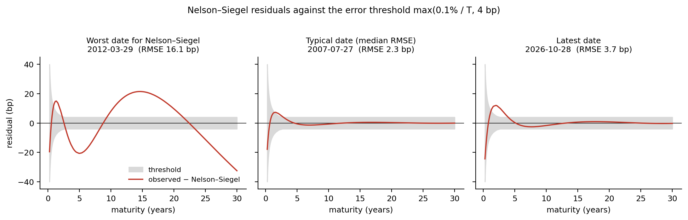
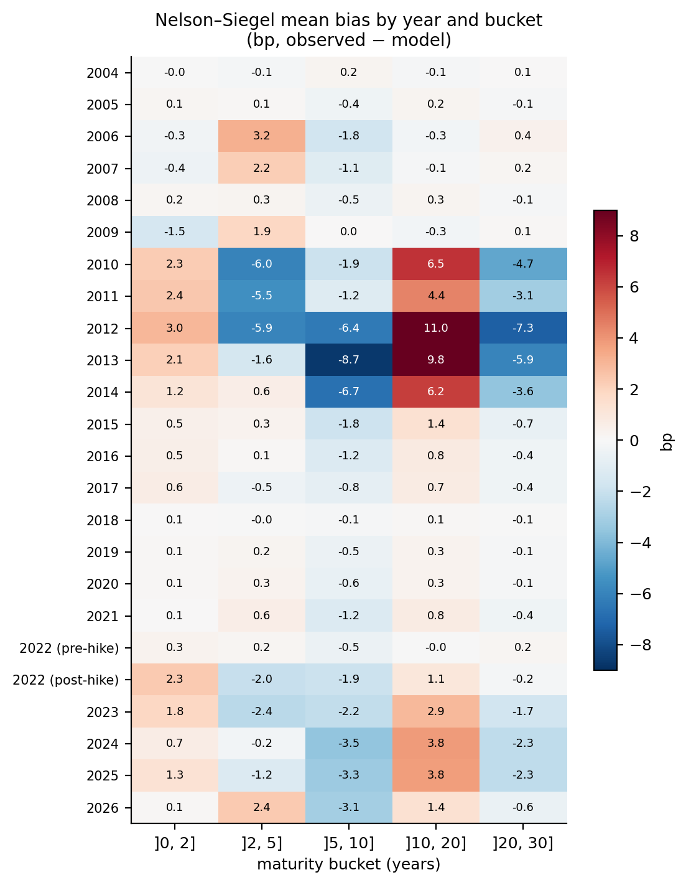
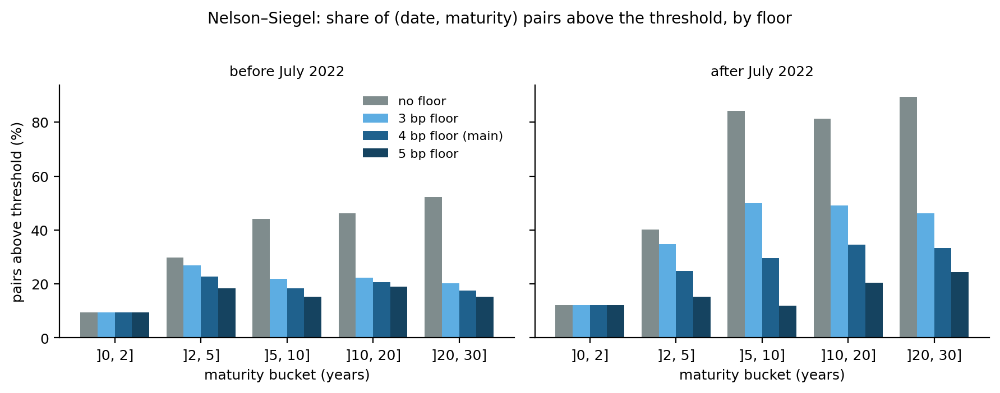

# Euro Yield Curve Model Validation: Nelson–Siegel vs Svensson

Validation of two yield-curve models (Nelson–Siegel, 4 parameters, and Svensson, 6 parameters) on 22 years of ECB AAA euro-area spot curves, run as a model reviewer would: residuals by maturity bucket and regime, bias tests robust to autocorrelation, an error threshold justified from an external source, and the impact of the model choice on the value and rate sensitivity of a bond portfolio.

**Scope.** This is model validation on yield curves, not ALM modelling: there is no behavioural option, no balance-sheet exposure and no client data. The reference curve is itself a Svensson fit published by the ECB, so the project does **not** say which model is better on the market. It measures what Nelson–Siegel loses relative to the ECB curve, where, and when.

## Data
- ECB Data Portal, dataset YC, AAA curve (series `YC.B.U2.EUR.4F.G_N_A.SV_C_YM.SR_*` and the parameters BETA0–3, TAU1–2).
- 5,662 daily curves (2004-09-06 to 2026-10-28), 197 maturities from 3 months to 30 years, no missing value. Rates are continuously compounded (confirmed by the ECB technical notes).
- Raw files are in `data/raw/` and are never modified.

## Method
- Residual = observed − model, at every (date, maturity) pair; results by maturity bucket ]0,2], ]2,5], ]5,10], ]10,20], ]20,30] and by regime (before / after the first ECB rate hike, 27 July 2022).
- Error threshold at maturity T: `max(0.1% / T, 4 bp)`, from a price tolerance of 0.1% on a cash flow and a floor tied to the precision of the ECB curve itself (ECB Statistics Paper No 27). See the decision log below for the order in which these were fixed.
- Bias tests: Newey–West (HAC) standard errors, with the number of lags varied, because daily residuals are strongly autocorrelated (ρ between 0.9 and 0.995).
- Portfolio impact: four fixed-rate bonds (3% coupon; 2, 5, 10, 20 years), priced with `exp(-r·t)` on each curve, under a +100 bp parallel shock and a slope shock (5 bp per year around a 10-year pivot).

## Key results
| | Nelson–Siegel | Svensson |
|---|---|---|
| (date, maturity) pairs above the threshold | 233,177 of 1,115,414 (20.9%) | 0 of 1,115,414 |
| RMSE per date, full curve | mean 3.4 bp, max 16.1 bp | max 0.048 bp |

- **Nelson–Siegel bias after July 2022** (bp, observed − model): +1.15 on ]0,2], −0.66 on ]2,5] (not detectable), −2.92 on ]5,10], +2.86 on ]10,20], −1.61 on ]20,30]. The sign pattern shows that a single curvature term cannot follow the curve. At 250 lags, |t| > 3.7 on four buckets out of five.
- **Before July 2022**, the average bias is dominated by 2010–2014 (e.g. +11 bp on ]10,20] in 2012 against less than 1 bp in 2018–2021). On the full pre-2022 period the Newey–West t-statistics do not stabilise as lags increase, so no single bias figure is reported for it.
- **Sensitivity to the floor**: after July 2022, on ]5,10], the share of pairs above the threshold goes from 84% (no floor) to 50% (3 bp), 30% (4 bp) and 12% (5 bp). The verdict on Nelson–Siegel depends on this choice.
- **Portfolio**: Nelson–Siegel values the 4-bond portfolio within 0.25% of the reference on at least 96.7% of dates, but the 20-year bond exceeds a 0.5% tolerance on 23% (before) and 54% (after) of dates. The sensitivity to the two shocks is reproduced within 0.08 point of price.

## Figures
Dates in the first figure are picked by rule, not by eye: the worst date for Nelson–Siegel, the date with the median RMSE, and the latest date.



A single curvature term leaves a structured residual: a short-end deviation on all three dates, and on the worst date a large hump at medium and long maturities. The grey band is the threshold.



The bias is close to zero in most years and concentrated in 2010–2014, which is why a single pre-2022 bias figure is not reported. The same sign pattern reappears after the July 2022 hike, with a smaller amplitude.



The verdict on Nelson–Siegel depends strongly on the floor, and the before/after comparison is not stable across floors.

## Decision log
| Decision | Fixed | Note |
|---|---|---|
| Regime boundary: 27 July 2022 | before results | first ECB hike |
| Hidden maturities (stratified, seed 42: 15 hidden, 182 anchor) | before results | same list for both models and all dates |
| Price tolerance 0.1% | before results | |
| Floor of 4 bp on the rate threshold | **after** first Nelson–Siegel results | anchored on ECB Statistics Paper No 27; results shown for 0, 3, 4, 5 bp |
| Svensson start grid widened from 15 to 56 starts | **after** 42 dates failed (RMSE above 0.05 bp) | all 42 recovered without ECB parameters; the 15-start run is kept in `hist_sv_grille15.csv` |
| Pre-2022 split into 2004–2009, 2010–2014, 2015–Jul 2022 | **after** the annual bias table | exploratory |
| Portfolio tolerances 0.1 / 0.25 / 0.5 / 1% | after the first value-error table | 0.1% stays the main one |
| Portfolio, shocks and measures | before results | |

## Limitations
- **Circular reference**: the ECB curve is a Svensson fit, so Svensson reproduces it by construction.
- **Svensson parameters are not unique**: the ECB's own TAU1 is below TAU2 on 3,195 dates and above on 2,467. Our fit lands in the same region on 77.7% of dates while reproducing the same curve, so curves are compared, not parameters.
- **ECB data**: on 39 dates our curve and the curve rebuilt from the ECB's published parameters differ by more than 0.05 bp (up to 5.6 bp on 23 June 2022, where our fit matches the published curve). The meaning of the lower bound of 0.25 on TAU is not documented in the sources consulted.
- **Weak independence**: ρ of 0.9 to 0.995 leaves few independent observations (for example about 57 effective observations out of 1,088 after July 2022 at ρ = 0.9). Differences between regimes are descriptive.
- **Floor source**: the ECB paper measures fit errors on bonds over 2003–2005 (a calm period), not on the zero-coupon curve used here.
- **Changing composition**: the euro-area reference area has a changing composition over the period.
- **Portfolio**: fictitious, four bonds, two shocks; no threshold is defined for the sensitivity error.
- **Not done**: stability of parameters over time (walk-forward) and a Diebold–Mariano comparison, since Svensson cannot lose against its own source curve.

## Repository
```
data/raw/            ECB CSV files (unmodified)
data/processed/      fitted parameters per date (hist_ns.csv, hist_sv.csv, hist_sv_grille15.csv)
src/curves/          Nelson–Siegel, Svensson, portfolio pricing, data loading
src/validation/      domain-independent functions: residuals and bias by group, quantiles,
                     autocorrelation, Newey–West test, split helpers
notebooks/           01 data exploration, 02 Nelson–Siegel, 03 Svensson, 04 validation,
                     05 start-grid diagnostic, 06 portfolio (part B)
tests/               unit tests (pytest)
scripts/             make_figures.py (regenerates the figures)
figures/             figures used in this README
```

## Reproduce
```bash
pip install -r requirements.txt
pytest
python scripts/make_figures.py   # regenerates figures/
```
Then run the notebooks in order. The full Svensson fit (about 2.5 minutes) is commented out in notebook 04; the fitted results are stored in `data/processed/`.

## Source
ECB, Euro area yield curves: https://www.ecb.europa.eu/stats/financial_markets_and_interest_rates/euro_area_yield_curves/html/index.en.html (ECB open data, reuse with attribution).
